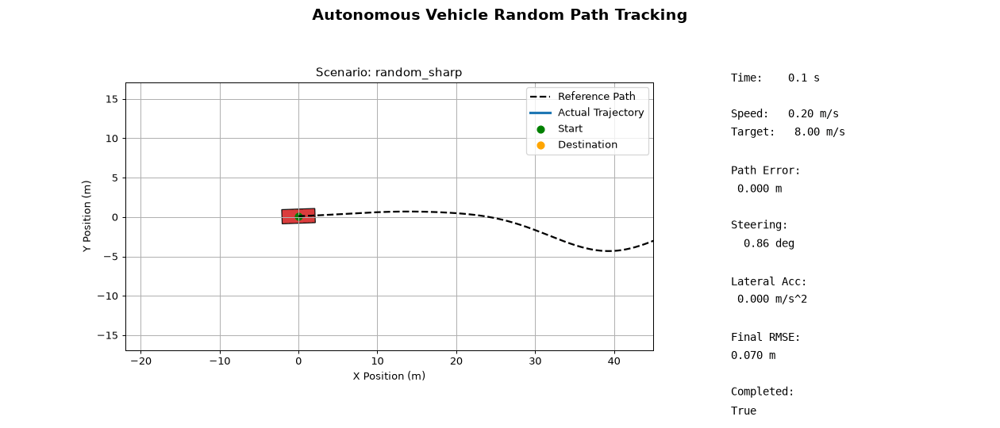
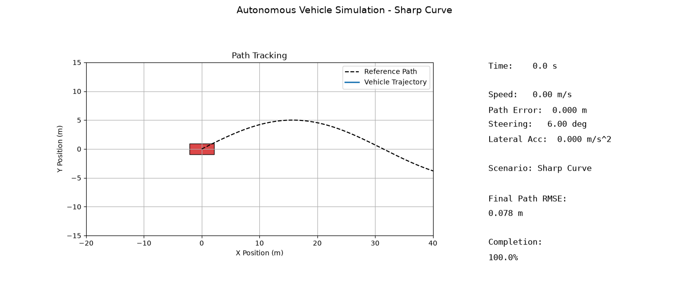
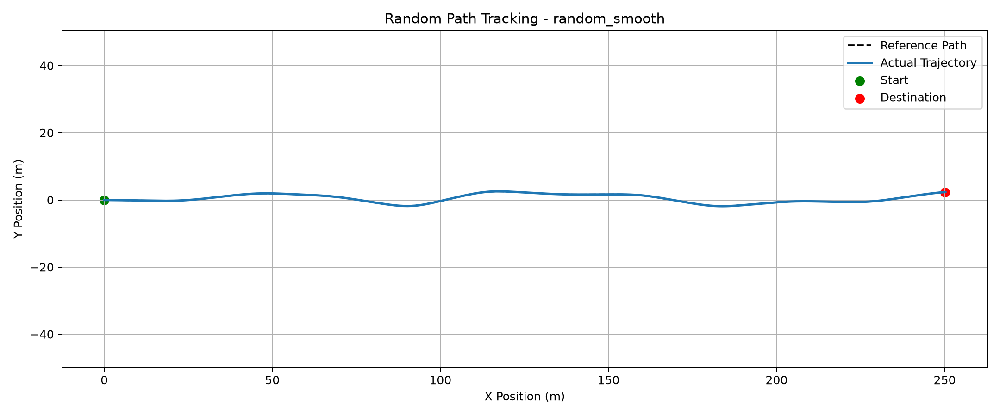
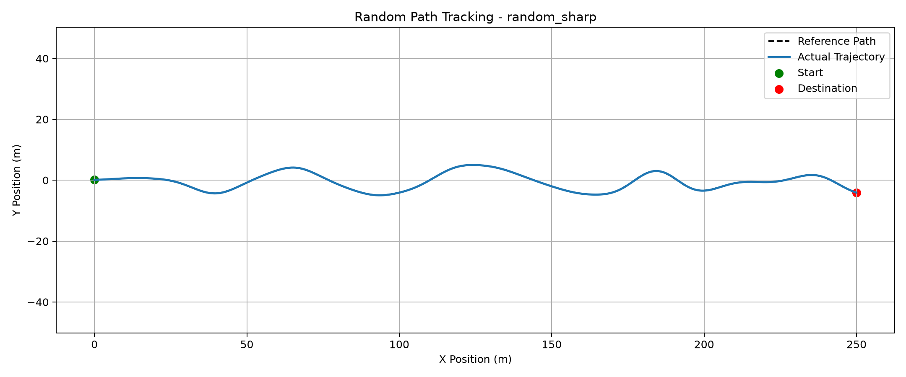
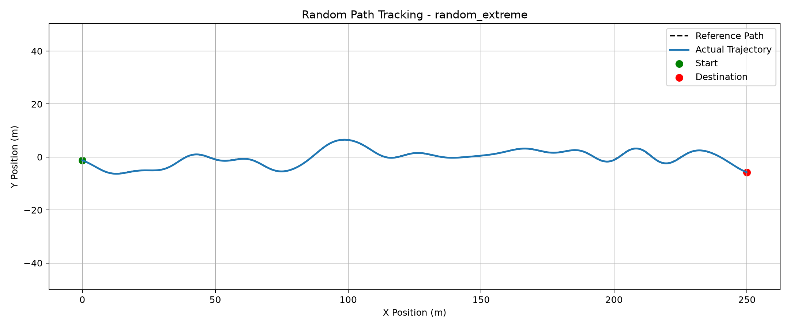

# Autonomous Vehicle Planning & Control Simulation

A Python-based autonomous vehicle simulation project focused on path tracking, vehicle dynamics, motion control, speed planning, and controller optimization.

**Developer:** Haoyuan Xu  
**University:** Virginia Tech  
**Major:** Mechanical Engineering  
**Language:** Python

---

## 1. Project Overview

This project develops a modular autonomous vehicle planning and control simulation framework using Python.

The simulation integrates:

- Kinematic Bicycle Model
- Pure Pursuit Lateral Controller
- Adaptive Lookahead Control
- Steering Rate Limiter
- PID Longitudinal Speed Controller
- Curvature-Based Speed Planning
- Controller Parameter Optimization
- Automated Scenario Testing
- Random Path Generation
- Stress Testing
- Vehicle Animation and Performance Visualization

The primary objective is to investigate how autonomous vehicles can accurately follow reference trajectories while maintaining stable steering and speed control.

The project also focuses on quantitative performance evaluation, reproducible experiments, and identifying limitations of the implemented controllers.

---

## 2. Project Demonstration

### 2.1 Random Path Tracking Animation

The vehicle follows a procedurally generated road with irregular turns and varying curvature.

The animation demonstrates the interaction between path planning, lateral steering control, and longitudinal speed control.



**Key visualization features:**

- Reference path and actual vehicle trajectory
- Vehicle position and heading
- Real-time steering response
- Target speed and actual speed
- Path tracking error
- Lateral acceleration

### 2.2 Original Vehicle Simulation

The original simulation demonstrates Pure Pursuit path tracking using the kinematic bicycle model.



---

## 3. Key Features

| Feature | Description |
|---|---|
| Kinematic Bicycle Model | Simulates planar vehicle motion |
| Pure Pursuit Controller | Computes steering commands to follow a reference path |
| Adaptive Lookahead | Adjusts lookahead distance based on vehicle speed |
| Steering Rate Limiter | Limits abrupt changes in steering commands |
| PID Speed Controller | Regulates longitudinal vehicle speed |
| Curvature-Based Speed Planner | Generates speed targets based on road curvature |
| Parameter Optimization | Evaluates different controller configurations |
| Scenario Testing | Tests multiple road geometries and operating speeds |
| Stress Testing | Evaluates controller behavior under challenging conditions |
| Random Path Generator | Generates reproducible irregular reference trajectories |
| Performance Visualization | Produces graphs, CSV results, and animated simulations |

---

## 4. System Architecture

The simulation operates as a closed-loop planning and control system.

```text
                 Reference Path
                       |
                       v
              Speed Planning Module
                       |
                       v
                  Target Speed
                       |
                       v
                 PID Controller
                       |
                       v
                  Acceleration
                       |
                       |
Vehicle State ---> Pure Pursuit Controller
                       |
                       v
                Steering Command
                       |
                       v
               Steering Rate Limiter
                       |
                       v
              Kinematic Bicycle Model
                       |
                       v
                Updated Vehicle State
                       |
                       v
               Performance Evaluation
                       |
                       +----> Feedback to Controllers
```

### Control Process

1. Generate or load a reference trajectory.
2. Calculate a target speed profile using road curvature.
3. Determine the lookahead target for lateral control.
4. Compute the steering angle using Pure Pursuit.
5. Apply steering rate limiting.
6. Compute acceleration using PID speed control.
7. Update the vehicle state using the bicycle model.
8. Record performance metrics.
9. Repeat the process until the simulation ends.

---

## 5. Vehicle Dynamics Model

The simulation uses a kinematic bicycle model to approximate planar vehicle motion.

### State Variables

The vehicle state includes:

- `x`: Longitudinal position
- `y`: Lateral position
- `yaw`: Vehicle heading angle
- `velocity`: Vehicle speed

### Control Inputs

- `steering_angle`: Front-wheel steering angle
- `acceleration`: Longitudinal acceleration

### Vehicle Motion Equations

```python
x_dot = velocity * cos(yaw)

y_dot = velocity * sin(yaw)

yaw_dot = (velocity / wheelbase) * tan(steering_angle)

velocity_dot = acceleration
```

Where `wheelbase` represents the distance between the front and rear axles.

The kinematic bicycle model provides a computationally efficient environment for developing and evaluating vehicle control algorithms.

---

## 6. Lateral Control: Pure Pursuit

Pure Pursuit is a geometric path-tracking algorithm.

The controller identifies a target point ahead of the vehicle and calculates the steering angle required to approach that point.

### Adaptive Lookahead

Instead of using a constant lookahead distance, the controller adjusts the lookahead distance according to vehicle speed.

```python
lookahead_distance = base_lookahead + gain * velocity
```

The lookahead distance affects controller behavior:

**Shorter lookahead distance:**

- Faster response to road curvature
- Potentially smaller tracking error
- More aggressive steering behavior

**Longer lookahead distance:**

- Smoother steering behavior
- Reduced steering sensitivity
- Potentially larger tracking error in sharp turns

### Steering Rate Limiter

A steering rate limiter is implemented to restrict sudden steering changes.

This prevents the commanded steering angle from changing instantaneously between simulation steps.

The limiter improves the realism of steering commands but does not fully represent a physical steering actuator.

---

## 7. Lookahead Parameter Optimization

A parameter sweep was conducted to determine an effective adaptive lookahead gain.

### Optimization Results

| Lookahead Gain (k) | Tracking RMSE |
|---|---|
| **0.20** | **0.064 m** |
| 0.40 | 0.065 m |
| 0.60 | 0.073 m |
| 0.80 | 0.093 m |
| 1.00 | 0.126 m |

The lowest tracking RMSE was achieved with:

**Optimized Lookahead Gain: k = 0.20**

### Cross-Scenario Validation

The optimized configuration was evaluated across 12 different test conditions.

**Results:**

- Improved RMSE in 12 out of 12 evaluated conditions
- Average reported RMSE improvement: 11.11%
- Reported spatial path coverage: 100%

These results indicate that the optimized configuration improved tracking performance under the evaluated simulation conditions.

However, the selected parameter is not necessarily optimal for all road geometries and driving conditions.

---

## 8. Longitudinal Control

The longitudinal controller uses PID feedback to regulate vehicle speed.

The controller calculates acceleration or braking commands based on the difference between target speed and actual speed.

### PID Control

The controller uses three components:

- Proportional control
- Integral control
- Derivative control

The combined controller attempts to reduce speed tracking error while maintaining a stable response.

---

## 9. Curvature-Based Speed Planning

The speed planner adjusts target speed according to road curvature.

Sharper turns generally require lower speeds to reduce lateral acceleration.

The relationship between lateral acceleration, vehicle speed, and curvature is:

```python
lateral_acceleration = velocity**2 * abs(curvature)
```

A curvature-based speed target can be calculated using:

```python
target_speed = sqrt(
    max_lateral_acceleration / abs(curvature)
)
```

In practice, the planner must also handle near-zero curvature and apply appropriate speed constraints.

### Lateral Acceleration Target

The relevant experiments use a planning target of:

**0.5 m/s²**

This is a target used by the speed planner, not a guaranteed limit on actual vehicle acceleration.

Tracking deviations and controller behavior may cause the simulated vehicle to exceed this value.

---

## 10. Scenario Testing

Automated scenario testing is implemented to evaluate the controller under different road geometries and operating conditions.

### Road Categories

- Gentle curves
- Medium curves
- Sharp curves

### Target Speeds

- 6 m/s
- 8 m/s
- 10 m/s
- 12 m/s

Two longitudinal control strategies are compared:

1. Fixed target speed
2. Curvature-based planned speed

This produces **24 test configurations**.

### Evaluation Metrics

- Root Mean Square Tracking Error (RMSE)
- Maximum tracking error
- Speed tracking behavior
- Maximum lateral acceleration
- Path completion

---

## 11. Random Path Tracking Challenge

To evaluate controller performance beyond predictable reference trajectories, the project includes a random path tracking experiment.

### Random Path Generation

The generator creates random lateral control points along a forward-moving road.

Interpolation and smoothing are used to generate continuous trajectories with varying curvature.

Random seeds allow the same trajectories to be reproduced for repeated experiments.

### Random Path Scenarios

| Scenario | Description |
|---|---|
| Random Smooth | Irregular road with relatively gentle turns |
| Random Sharp | More frequent and pronounced curvature changes |
| Random Extreme | Stronger directional changes and more challenging geometry |

### Random Smooth Tracking



### Random Sharp Tracking



### Random Extreme Tracking



### Performance Evaluation

The random path tracking experiment records:

- Tracking RMSE
- Maximum tracking error
- Maximum lateral acceleration
- Path progress
- Path completion status
- Numerical failure status
- Simulation duration

Results are exported to:

```text
results/random_tracking/random_tracking_results.csv
```

This experiment is intended to reveal both successful tracking behavior and potential controller failure cases.

---

## 12. Stress Testing

Six stress-test scenarios were evaluated to examine controller robustness.

| Scenario | Description |
|---|---|
| Normal | Standard initial conditions |
| Large Offset | Large initial lateral displacement |
| Heading Error | Incorrect initial heading |
| Sharp Curve | Increased road curvature |
| Low Speed | Reduced operating speed |
| Combined Stress | Multiple challenging conditions combined |

All six scenarios passed the project's preliminary tracking and completion criteria.

However, passing these criteria does not guarantee that the vehicle satisfies all desired dynamic constraints.

### Maximum Lateral Acceleration

| Scenario | Maximum Lateral Acceleration |
|---|---|
| Normal | 1.073 m/s² |
| Large Offset | 6.628 m/s² |
| Heading Error | 0.979 m/s² |
| Sharp Curve | 2.074 m/s² |
| Low Speed | 0.094 m/s² |
| Combined Stress | 6.119 m/s² |

Five of the six scenarios exceeded the lateral acceleration planning target of 0.5 m/s².

### Engineering Observation

**Accurate path tracking does not necessarily guarantee acceptable vehicle dynamics.**

This result highlights the importance of improving speed planning, dynamic constraint enforcement, and controller robustness.

---

## 13. Installation

### Requirements

- Python 3.10 or newer
- NumPy
- Matplotlib
- Pillow

### Clone the Repository

```bash
git clone https://github.com/Xuhaoyuan-creator/autonomous-driving-planning-control.git

cd autonomous-driving-planning-control
```

### Create a Virtual Environment

```bash
python -m venv .venv
```

### Activate the Environment

Windows PowerShell:

```powershell
.\.venv\Scripts\Activate.ps1
```

### Install Dependencies

```bash
pip install -r requirements.txt
```

---

## 14. Running the Project

Run the following commands from the project root directory.

### Generate Random Paths

```bash
python random_path_generator.py
```

### Run Random Path Tracking

```bash
python random_path_tracking.py
```

### Generate Random Path Animation

```bash
python random_path_animation.py
```

### Run Scenario Testing

```bash
python scenario_testing.py
```

### Optimize Lookahead Parameters

```bash
python optimize_lookahead.py
```

### Validate Lookahead Optimization

```bash
python validate_lookahead.py
```

### Run Stress Tests

```bash
python stress_testing.py
```

### Generate Original Vehicle Animation

```bash
python vehicle_animation.py
```

### Generate Performance Report

```bash
python generate_performance_report.py
```

---

## 15. Results and Documentation

Simulation outputs are stored in the `results/` directory.

The project generates:

- Vehicle trajectory visualizations
- Path tracking error plots
- Speed tracking plots
- Lateral acceleration plots
- Controller optimization results
- Cross-scenario validation results
- Stress-test results
- Random path tracking results
- Animated vehicle simulations
- CSV performance data

### Technical Performance Report

[View the Full Performance Report](results/performance_report/PERFORMANCE_REPORT.md)

---

## 16. Technologies Used

| Category | Technologies |
|---|---|
| Programming Language | Python |
| Numerical Computing | NumPy |
| Visualization | Matplotlib, Pillow |
| Vehicle Modeling | Kinematic Bicycle Model |
| Lateral Control | Pure Pursuit |
| Longitudinal Control | PID |
| Speed Planning | Curvature-Based Speed Planning |
| Optimization | Parameter Sweeps |
| Testing | Scenario Testing and Stress Testing |
| Development Tools | VS Code, Git, GitHub |

---

## 17. Future Development

### Dynamic Constraint Enforcement

Improve speed planning and feedback control to reduce lateral acceleration violations.

### Dynamic Bicycle Model

Introduce more realistic lateral vehicle dynamics, including tire forces and vehicle sideslip.

### Advanced Path Generation

Implement spline-based reference paths and improved curvature estimation.

### Controller Comparison

Implement additional lateral controllers, including:

- Stanley Controller
- Model Predictive Control (MPC)

### Automated Robustness Testing

Expand randomized experiments across different road geometries, initial conditions, and vehicle parameters.

### Enhanced Visualization

Develop side-by-side animations comparing different controller configurations and speed planning strategies.

### Software Engineering Improvements

Add automated regression testing, continuous integration, and improved experiment configuration.

---

## 18. Project Limitations

This simulation uses a simplified kinematic bicycle model.

It does not fully represent:

- Tire force saturation
- Suspension dynamics
- Detailed steering actuator behavior
- Full nonlinear vehicle dynamics
- Real-world sensor uncertainty

The experimental results apply only to the implemented simulation models, parameters, and test conditions.

This project is intended for educational and engineering experimentation and is not validated for autonomous driving deployment on public roads.

---

## 19. About the Developer

**Haoyuan Xu**

Mechanical Engineering Student  
Virginia Tech

Interested in:

- Autonomous Driving
- Vehicle Dynamics
- Motion Planning
- Control Systems
- Simulation-Based Engineering

**GitHub:** [Xuhaoyuan-creator](https://github.com/Xuhaoyuan-creator)

---

## License

No license has been specified for this repository.