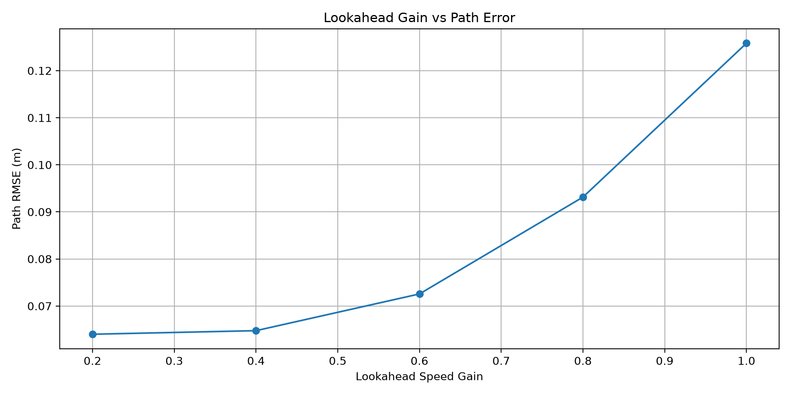
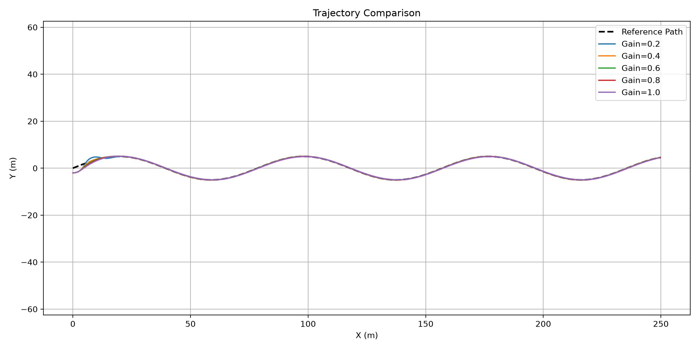
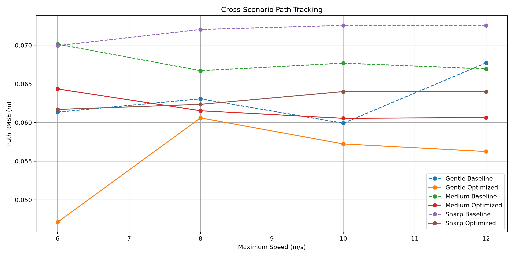
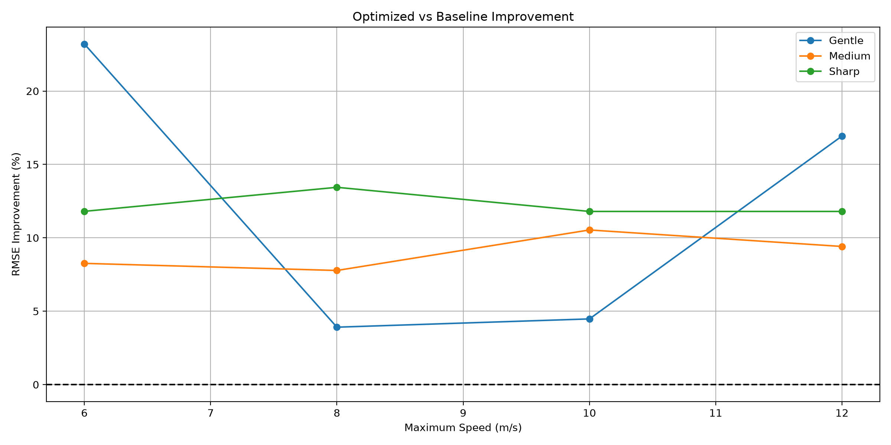
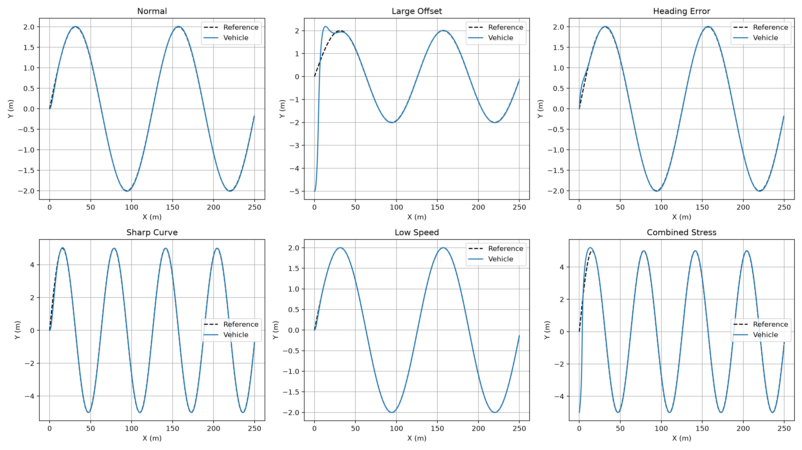
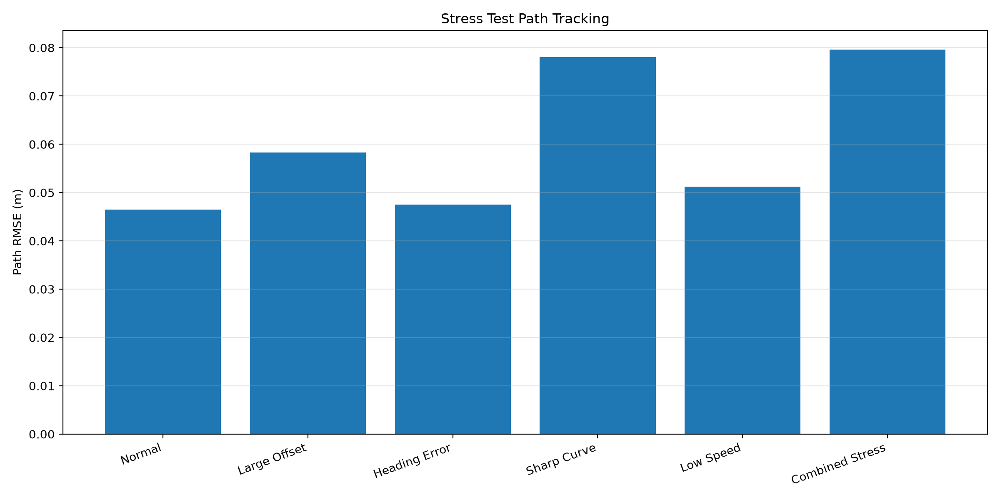
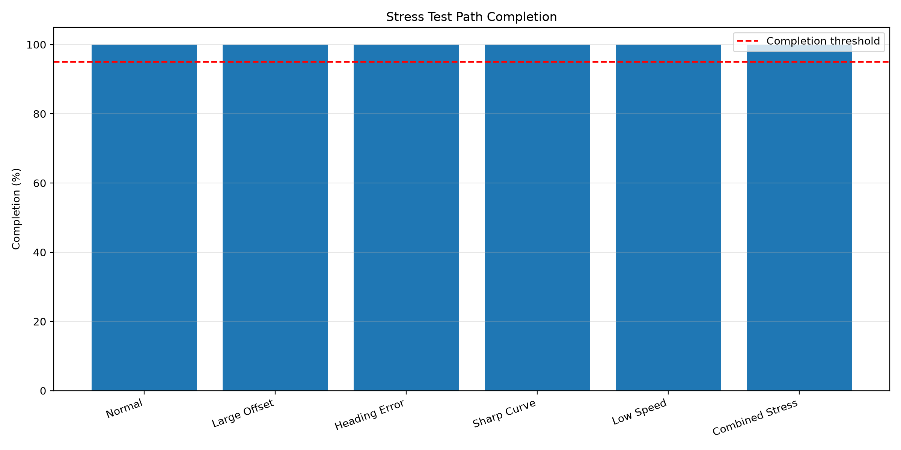

# Autonomous Vehicle Planning and Control

**Technical Performance Report**

Generated: 2026-11-10


## 1. Project Overview

This project develops a Python-based autonomous
vehicle path tracking and speed control simulation.

The system combines:

- Kinematic bicycle vehicle model
- Pure Pursuit lateral controller
- Adaptive lookahead distance
- Steering rate limiter
- PID longitudinal speed controller
- Curvature-based speed planner
- Automated scenario evaluation
- Robustness stress testing

### Main Objectives

1. Track a reference path accurately.
2. Adjust vehicle speed based on road curvature.
3. Compare different control strategies.
4. Evaluate controller performance across scenarios.
5. Test robustness under challenging conditions.

### Vehicle Control Architecture

```text
Reference Path
    |
    +--> Speed Planner --> PID Controller
    |                         |
    |                         v
    |                    Acceleration
    |
    +--> Pure Pursuit --> Steering Limiter
                              |
                              v
                          Steering

Acceleration + Steering
          |
          v
   Kinematic Bicycle Model
          |
          v
      Vehicle State
```


## 2. Multi-Scenario Testing

The simulation evaluates vehicle behavior
under different road geometries and speeds.

The purpose is to compare control performance
under changing operating conditions.

Total recorded rows: 24

Detailed scenario data is available in `results/scenario_testing/scenario_results.csv`.

The original scenario evaluation compares fixed-speed driving with curvature-aware speed planning. Any claimed improvement should be based on matched road segments and verified coverage.


## 3. Adaptive Lookahead Optimization

The Pure Pursuit controller uses:

```text
Ld = 2 + k * v
```

where:

- Ld: lookahead distance (m)
- k: speed-dependent lookahead gain
- v: vehicle speed (m/s)

Different gain values were evaluated to
identify a suitable tracking configuration.

| Gain k | Path RMSE (m) | Common Coverage |
| --- | --- | --- |
| 0.20 | 0.064 | 1.00 |
| 0.40 | 0.065 | 1.00 |
| 0.60 | 0.073 | 1.00 |
| 0.80 | 0.093 | 1.00 |
| 1.00 | 0.126 | 1.00 |

Lowest-RMSE candidate on the optimization scenario:

- Gain: **0.20**
- Path RMSE: **0.064 m**

This is a scenario-specific candidate, not proof of global optimality.


## 4. Cross-Scenario Validation

The optimized lookahead gain is compared
against the baseline gain of k = 0.6.

Validation uses matched spatial segments
to reduce bias from different vehicle speeds.

| Road | Speed (m/s) | Baseline RMSE | Optimized RMSE | Improvement (%) | Coverage (%) | Reliable |
| --- | --- | --- | --- | --- | --- | --- |
| Gentle | 6.0 | 0.061 | 0.047 | 23.21 | 100.0 | Yes |
| Gentle | 8.0 | 0.063 | 0.061 | 3.91 | 100.0 | Yes |
| Gentle | 10.0 | 0.060 | 0.057 | 4.47 | 100.0 | Yes |
| Gentle | 12.0 | 0.068 | 0.056 | 16.93 | 100.0 | Yes |
| Medium | 6.0 | 0.070 | 0.064 | 8.26 | 100.0 | Yes |
| Medium | 8.0 | 0.067 | 0.062 | 7.77 | 100.0 | Yes |
| Medium | 10.0 | 0.068 | 0.061 | 10.54 | 100.0 | Yes |
| Medium | 12.0 | 0.067 | 0.061 | 9.41 | 100.0 | Yes |
| Sharp | 6.0 | 0.070 | 0.062 | 11.80 | 100.0 | Yes |
| Sharp | 8.0 | 0.072 | 0.062 | 13.44 | 100.0 | Yes |
| Sharp | 10.0 | 0.073 | 0.064 | 11.80 | 100.0 | Yes |
| Sharp | 12.0 | 0.073 | 0.064 | 11.80 | 100.0 | Yes |

Reliable scenarios: **12/12**

- Optimized controller wins: **12/12**
- Mean RMSE improvement: **11.11%**

These results describe tracking accuracy on sufficiently covered scenarios. Lateral acceleration and completion should also be considered before selecting a final controller.


## 5. Robustness Stress Testing

Six conditions are evaluated:

1. Normal driving
2. Large initial lateral offset
3. Initial heading error
4. Sharp curves
5. Low-speed driving
6. Combined disturbances

The tests assess numerical stability,
path tracking error, and route progress.

| Scenario | RMSE (m) | Max Error (m) | Max Lateral Acc (m/s^2) | Completion (%) | Status |
| --- | --- | --- | --- | --- | --- |
| Normal | 0.046 | 0.100 | 1.073 | 100.0 | PASS |
| Large Offset | 0.058 | 0.099 | 6.628 | 100.0 | PASS |
| Heading Error | 0.047 | 0.100 | 0.979 | 100.0 | PASS |
| Sharp Curve | 0.078 | 0.125 | 2.074 | 100.0 | PASS |
| Low Speed | 0.051 | 0.100 | 0.094 | 100.0 | PASS |
| Combined Stress | 0.080 | 0.127 | 6.119 | 100.0 | PASS |

Stress tests passed: **6/6**

The PASS status reflects preliminary tracking and completion criteria. It does not enforce a strict lateral acceleration limit or establish real-world vehicle safety.


### Interpretation Notes

The test thresholds are preliminary engineering
criteria, not real-world safety certification.

The first 10 seconds are excluded from the
tracking RMSE calculation to allow recovery
from initial disturbances.

Completion is estimated from reference-path
index progress, so the trajectory plot should
also be checked.

Low-speed scenarios may have lower completion
because the simulation has a fixed time limit.


## 6. Visual Results

### Lookahead Optimization





### Cross-Scenario Validation





### Robustness Testing







### Vehicle Animation

[View Vehicle Simulation GIF](../animation/vehicle_simulation.gif)


## 7. Limitations

The current implementation has several
important limitations:

- Uses a kinematic rather than dynamic
  vehicle model.
- Does not model tire slip or road friction.
- Does not include perception or obstacles.
- Does not include real sensor noise.
- Uses idealized reference paths.
- Has not been validated on a real vehicle.
- Some completion metrics use approximate
  reference-path progress.

### Lateral Acceleration Limitations

The curvature-based speed planner was configured
with a target lateral acceleration of
**0.5 m/s^2**.

However, the robustness tests showed that
actual lateral acceleration can exceed this
target, particularly during recovery from
large initial tracking errors.

| Scenario | Max Lateral Acc (m/s^2) | Exceeds Target |
| --- | --- | --- |
| Normal | 1.073 | Yes |
| Large Offset | 6.628 | Yes |
| Heading Error | 0.979 | Yes |
| Sharp Curve | 2.074 | Yes |
| Low Speed | 0.094 | No |
| Combined Stress | 6.119 | Yes |

Scenarios exceeding the 0.5 m/s^2 target: **5/6**

The highest recorded lateral acceleration was **6.628 m/s^2** in the **Large Offset** scenario.


The speed planner calculates target speeds
using reference-path curvature. Actual vehicle
motion can produce greater lateral acceleration,
especially when recovering from initial position
or heading errors.

The current stress-test PASS criteria do not
enforce the lateral acceleration target.

Therefore, passing the tests does not establish
passenger comfort or real-world dynamic safety.

### Future Improvements

1. Monitor and constrain actual lateral acceleration.
2. Reduce speed during large path-tracking errors.
3. Incorporate dynamic vehicle and tire models.
4. Evaluate comfort and stability constraints.
5. Test controller behavior under sensor noise.

The results demonstrate simulated control
performance, not production-level autonomy.


## 8. Conclusion

This project implements and evaluates an
autonomous vehicle path tracking and speed
control framework using Python.

The developed system integrates:

- Pure Pursuit lateral control
- PID longitudinal control
- Curvature-aware speed planning
- Steering rate limiting
- Automated performance evaluation
- Parameter optimization
- Cross-scenario validation
- Robustness testing

The experimental results provide a basis
for understanding controller behavior
under different operating conditions.

The robustness evaluation also identifies
limitations in lateral acceleration control,
which should be addressed in future work.

Future development may include dynamic bicycle
models, Model Predictive Control (MPC),
and ROS 2 integration.

